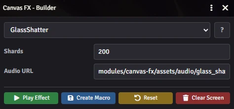
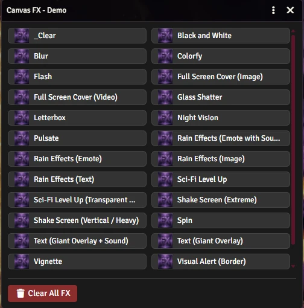

# Canvas FX

Canvas FX plays screen effects in Foundry VTT v14 from a macro: emoji rain, a screen shake, a lightning flash, letterbox bars, a sepia flashback. The effect covers the whole screen, above the Foundry interface, and every connected player sees it at the same moment.

[](https://buymeacoffee.com/mestredigital) [](https://mestredigital.online/pages/projetos-en)

## What it can do

- Rain emojis (🔥, ❄️, 💰), text or your own images across the screen, from any of the four sides.
- Shake the screen, shatter it like glass, or flash it in any color for lightning and explosions.
- Close the scene with theater curtains, add letterbox bars, run a slideshow from a folder, or cover the screen with an image or video.
- Apply full-screen filters: Blur, Night Vision, Black & White, Sepia, Vignette, a color tint, Film Grain and Frost. Several can be on at once.
- Show giant text that can pulse or shake, a pulsing colored border for low health, or a countdown.
- Spin the whole view, or make it pulse like a heartbeat.
- Show a 3D holographic "Level Up" HUD (Three.js) whose text erupts into particles once it has fully formed. It has a solid black backdrop by default and can also be transparent.
- Play a sound together with any of these.

## How to use it

The effects are triggered by script macros. You don't need to know how to code: the documentation has an example to copy and paste for every effect.

### 1. Try the effects

Before writing a macro, you can preview the effects with two tools:

- `CanvasFX.Builder()` opens a window where you change the settings, play the effect right away and turn it into a macro with one click.
- `CanvasFX.Demo()` opens a gallery of ready-made examples.

| Builder: tweak settings, play, and generate a macro | Demo: gallery of ready-made examples |
| :---: | :---: |
|  |  |

### 2. Write your macros

Once you have chosen an effect, the API reference has the exact code to put in your macro, with every option.

[Read the API Reference](docs/API.md)

## Installation

The module requires Foundry VTT v14.

1.  Copy this manifest link:

```
https://github.com/brunocalado/canvas-fx/releases/latest/download/module.json
```
    
2.  In Foundry VTT, go to **Add-on Modules** -> **Install Module**.
3.  Paste the link into the **Manifest URL** field and click Install.

## License

Code licensed under [LICENSE](LICENSE).

*Bundles [Three.js](https://threejs.org) (MIT, see `lib/LICENSE-three.md`) for the 3D effects.*
